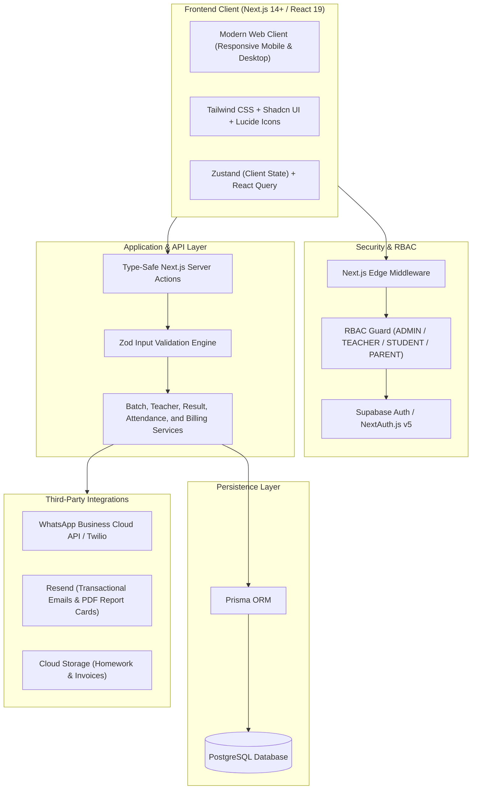

# TutorOS — Master Product Requirements & Technical Specification

> **Project Name:** TutorOS  
> **Tagline:** The All-in-One Operating System for Modern Tutors, Academies & Teachers  
> **Version:** 1.0.0  
> **Status:** Approved Specification  

---

## Modular Documentation Index

This master document provides a comprehensive overview. For deep-dive domain documents, reference the modular `.md` files in the [`docs/`](file:///d:/AMIR/TutorOS/docs/) directory:

- 📄 **Requirements & Scope:** [`docs/01_PRODUCT_REQUIREMENTS.md`](file:///d:/AMIR/TutorOS/docs/01_PRODUCT_REQUIREMENTS.md)
- 🏗️ **Architecture & Data Models:** [`docs/02_ARCHITECTURE_AND_TECH_STACK.md`](file:///d:/AMIR/TutorOS/docs/02_ARCHITECTURE_AND_TECH_STACK.md)
- 🛡️ **Rules & Standards:** [`docs/03_ENGINEERING_RULES_AND_BOUNDARIES.md`](file:///d:/AMIR/TutorOS/docs/03_ENGINEERING_RULES_AND_BOUNDARIES.md)
- 🚀 **Phased Implementation Plan:** [`docs/04_PHASED_IMPLEMENTATION_PLAN.md`](file:///d:/AMIR/TutorOS/docs/04_PHASED_IMPLEMENTATION_PLAN.md)
- 🎨 **Design System & Typography:** [`docs/05_DESIGN_SYSTEM.md`](file:///d:/AMIR/TutorOS/docs/05_DESIGN_SYSTEM.md)
- 📘 **Project Readme:** [`README.md`](file:///d:/AMIR/TutorOS/README.md)

---

## 1. Project Requirements Document (PRD)

### 1.1 What App to Build
**TutorOS** is an all-in-one operating platform engineered for independent tutors, private coaching academies, faculty teachers, and students. It eliminates spreadsheets, paper logs, and manual messaging by unifying:
- **Teacher Information Management:** Storing comprehensive teacher profiles, qualifications, subject specializations, and compensation models.
- **Class & Student Batch Segregation:** Structuring students into segregated class cohorts/batches (by subject, grade level, or schedule) with assigned teachers, preventing scheduling clashes and data confusion.
- **Flexible Subject Tuition (All vs 1–2 Subjects):** Enabling students to enroll in full curriculum bundles or selectively in 1 or 2 specific subjects with dynamic fee structures.
- **Semester-Wise Student Results & Report Cards:** Managing terms and semesters, recording subject-wise exam marks, dynamic GPA calculation, and auto-generating branded PDF report cards.
- **Interactive Scheduling:** Multi-teacher, multi-batch timetable engine with clash detection and 1-click meeting links (Zoom/Google Meet/Offline).
- **1-Click Attendance & Digital Lesson Logs:** Real-time presence tracking, topic coverage, and assigned homework.
- **Automated Invoicing & Payment Tracking:** Generating tuition fee invoices and tracking payment statuses.
- **Smart Automated Alerts:** Sending instant class reminders, homework notifications, and overdue fee alerts via WhatsApp and Email.

---

### 1.2 Target Users & Personas

| Role / Persona | Profile & Needs | Primary Goal in TutorOS |
| :--- | :--- | :--- |
| **Academy Admin / Solo Tutor** | Operates the tutoring business or coaching academy. Struggles with managing multiple teachers, tracking student batches, keeping tabs on unpaid dues, and calendar collisions. | Master dashboard, batch creation, teacher assignment, automated fee billing, and business revenue analytics. |
| **Teachers / Instructors** | Hired or independent educators assigned to teach specific batches or 1-on-1 students. Struggles to know which batch is next, who attended, and logging homework. | Teacher portal to view assigned batches, today's schedule, 1-click attendance marking, marks entry, and homework logging. |
| **Students & Batches** | Enrolled in specific subjects/batches (e.g., Grade 10 Math Batch A, SAT Prep Weekend). | View upcoming batch classes, access lesson notes, submit homework, view semester report cards, and view attendance stats. |
| **Parents (Guardian View)** | Pays tuition fees and wants transparency on student attendance, academic progress, and invoices. | Receive automated WhatsApp/Email reminders, view invoice receipts, semester report cards, and check attendance/lesson progress. |

---

### 1.3 Core Feature Breakdown

```
TutorOS Core Features
├── 1. Authentication & Security (RBAC)
│   ├── Roles: ADMIN, TEACHER, STUDENT, PARENT
│   ├── Email/Password + Google OAuth
│   └── Next.js Middleware route protection
│
├── 2. Executive Command Center (Dashboard)
│   ├── Real-time KPI Stats (Active Students, Revenue, Classes Today, Unpaid Dues)
│   ├── "Today's Agenda" Timeline (Upcoming sessions with 1-click Join / Attendance)
│   └── Quick Action Toolbar (+ New Student, + New Batch, + Add Teacher, + Invoice)
│
├── 3. Teacher Management Directory
│   ├── Teacher Profiles (Subjects, Qualifications, Hourly Rate / Salary)
│   ├── Assigned Batches & Students
│   └── Teacher Working Hours & Availability
│
├── 4. Class Batch & Student Batch Segregation
│   ├── Batch Creation (Subject, Teacher, Max Capacity, Room/Link, Recurring Slots)
│   ├── Student Batch Roster & Segregation (preventing multi-batch data collisions)
│   └── Batch-level Attendance & Performance
│
├── 5. Flexible Subject Tuition / Enrollment
│   ├── All-Subjects Comprehensive Bundle
│   ├── Modular 1–2 Subject Selection (e.g., Math Only or Math + Physics)
│   └── Dynamic tuition fee calculation per subject
│
├── 6. Semester-Wise Student Results & Report Cards
│   ├── Academic Terms & Semesters (Semester 1, Semester 2, Midterms, Finals)
│   ├── Subject-wise Marksheet & Grade Entry (A+, A, B, etc.)
│   ├── Dynamic GPA & Percentage computation (strictly for enrolled subjects)
│   └── Branded PDF Report Card generation & Parent/Student portal visibility
│
├── 7. Calendar & Scheduling Engine
│   ├── Multi-view Calendar (Day/Week/Month, Teacher filter)
│   ├── Conflict Detection (prevents double-booking teachers/batches)
│   └── Recurring weekly slots & Zoom/Google Meet links
│
├── 8. Attendance & Lesson Notes
│   ├── 1-Click Attendance (Present, Absent, Late, Excused)
│   ├── Lesson Topic Coverage & Homework Log
│   └── Shared parent notes vs. Private tutor notes
│
├── 9. Invoicing & Financials
│   ├── Automated Invoices (Hourly, recurring monthly batch, or modular subject fee)
│   ├── Payment Tracking (Paid, Pending, Overdue)
│   └── Branded PDF Receipts
│
└── 10. Communication & Alerts (WhatsApp / Email)
    ├── Automated Class Reminders (1h and 15m before class)
    ├── Post-class Homework & Attendance Summary
    ├── Overdue Fee Reminder Alerts
    └── Semester Report Card PDF dispatch
```

---

## 2. Architecture & Tech Stack

### 2.1 High-Level Architecture Flow



### 2.2 Tech Stack Selection

- **Frontend / Framework:** Next.js 14+ (App Router, Server Components, Server Actions)
- **Language:** TypeScript 5 (Strict Mode)
- **Styling:** Tailwind CSS + Shadcn UI (Radix UI)
- **Database & ORM:** PostgreSQL + Prisma ORM
- **Authentication:** Supabase Auth or NextAuth.js v5 (RBAC)
- **Form Management:** React Hook Form + Zod
- **Visuals & Charts:** Recharts + Lucide React
- **Notifications:** WhatsApp Business Cloud API & Resend Email

---

## 3. Engineering Rules & Boundaries

- **Strict TypeScript:** No `any`. Strict null checking.
- **Server-Side Validation:** All mutations validated by Zod on the server.
- **Enrolled Subject Scope:** GPA and percentage calculations must strictly aggregate over the subjects the student is actively enrolled in.
- **Tenant & Batch Scoping:** Every query must enforce workspace and batch-level isolation.
- **Standardized Server Action Returns:**
  ```typescript
  type ActionResponse<T> = 
    | { success: true; data: T; message?: string }
    | { success: false; error: string; fieldErrors?: Record<string, string[]> };
  ```
- **Secrets Isolation:** Never prefix private API keys with `NEXT_PUBLIC_`.
- **Error Boundaries:** Route `error.tsx` and custom Skeleton `loading.tsx` implementations.

---

## 4. Phase-by-Phase Roadmap

### Phase 1: Authentication & Executive Dashboard (Sprint 1)
- **Phase 1A: Multi-Role Auth:** Login, Register, Google OAuth, role-based redirects.
- **Phase 1B: Executive Command Center:** 4 Key KPI cards, Today's Live Agenda feed with 1-click launch, and Quick Action toolbar.

### Phase 2: Teacher Management & Batch Segregation (Sprint 2)
- Teacher profiles, subject assignments, and compensation models.
- Modular subject enrollment (All subjects bundle vs. 1–2 subjects).
- Batch creation, student batch segregation, and roster management.

### Phase 3: Calendar & Scheduling Engine (Sprint 3)
- Multi-teacher timetable, recurring schedules, and conflict detection.

### Phase 4: Attendance, Lesson Logs, Invoicing & Semester Results (Sprint 4)
- 1-click batch attendance and homework tracking.
- Modular fee calculation & PDF invoices.
- Semester-wise exam marksheet entry, GPA calculation, and downloadable branded report cards.

### Phase 5: Automated Alerts & Client Portal (Sprint 5)
- Automated WhatsApp & Email notifications (Class reminders, fee receipts, report cards).
- Student and Parent self-service portal.

---

## 5. Design System

- **Brand Primary:** `#1E293B` (Slate Navy) / `#4338CA` (Indigo 700)
- **Accent Success:** `#059669` (Emerald 600 - Paid & Distinction Grades)
- **Accent Warning:** `#D97706` (Amber 600 - Classes starting soon & Pending dues)
- **Destructive:** `#DC2626` (Red 600 - Overdue & Failed marks)
- **Primary Typography:** `Plus Jakarta Sans` or `Inter` (sans-serif)
- **Numerical Typography:** `JetBrains Mono` or tabular figures for marks, GPA, fee columns, and schedules.
