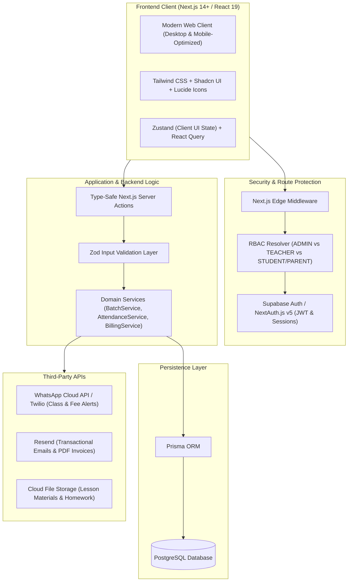
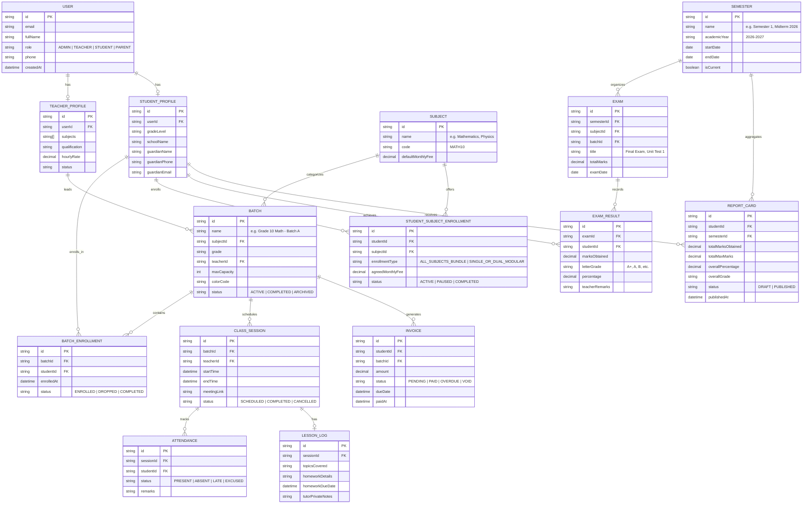

# 02. Architecture, Data Model & Tech Stack

> **Project:** TutorOS  
> **Document:** System Architecture, Data Relationships & Tech Stack  
> **Status:** Approved Specification  

---

## 1. System Architecture & App Flow



---

## 2. Relational Data Model (Batch Segregation & Teacher Architecture)

Below is the core entity schema supporting multi-teacher assignment and student-batch segregation.



---

## 3. Directory & Folder Structure

```
TutorOS/
├── prisma/
│   ├── schema.prisma                  # PostgreSQL models (User, Teacher, Student, Batch, Semester, Exam, etc.)
│   └── seed.ts                        # Sample seed data (Teachers, Batches, Students, Exams)
├── public/
│   ├── logo.svg
│   └── illustrations/
├── src/
│   ├── app/                           # Next.js 14+ App Router
│   │   ├── (auth)/                    # Public Auth Routes
│   │   │   ├── login/page.tsx
│   │   │   ├── register/page.tsx
│   │   │   ├── forgot-password/page.tsx
│   │   │   └── layout.tsx
│   │   ├── (dashboard)/               # Protected Workspace Shell
│   │   │   ├── dashboard/page.tsx     # Role-aware Command Center
│   │   │   ├── teachers/              # Teacher Management Directory
│   │   │   │   ├── page.tsx           # All Teachers List & Performance
│   │   │   │   └── [id]/page.tsx      # Teacher Profile, Assigned Batches & Rates
│   │   │   ├── batches/               # Class Batch Management & Segregation
│   │   │   │   ├── page.tsx           # Batch Directory & Capacity Overview
│   │   │   │   └── [id]/page.tsx      # Batch Roster, Teacher, Schedule, Attendance
│   │   │   ├── students/              # Student CRM & Subject Enrollment
│   │   │   │   ├── page.tsx           # Filtered by Batch, Subject or All Students
│   │   │   │   └── [id]/page.tsx      # Student File, Subject Pick, Parent & Billing
│   │   │   ├── results/               # Semester Results & Report Cards
│   │   │   │   ├── page.tsx           # Semester overview, GPA analytics & publish
│   │   │   │   ├── enter-marks/page.tsx # Quick marks entry by batch / subject
│   │   │   │   └── report-card/[studentId]/page.tsx # Printable PDF Report Card
│   │   │   ├── schedule/              # Timetable & Calendar Engine
│   │   │   │   └── page.tsx           # Multi-teacher & batch conflict view
│   │   │   ├── attendance/            # Quick Attendance & Lesson Logging
│   │   │   │   └── page.tsx
│   │   │   ├── billing/               # Invoices & Financial Reports
│   │   │   │   └── page.tsx           # Auto-calculated fees (Bundle vs 1-2 Subjects)
│   │   │   ├── settings/page.tsx      # Academy Branding, Alert Settings
│   │   │   └── layout.tsx             # Dashboard Shell (Sidebar, Topbar, UserMenu)
│   │   ├── api/                       # Webhooks (WhatsApp alerts / Payment callbacks)
│   │   ├── error.tsx                  # Global Error Boundary
│   │   ├── loading.tsx                # App-wide Skeleton Loader
│   │   └── layout.tsx                 # Root Layout with Font & Toaster Providers
│   ├── components/
│   │   ├── ui/                        # Shadcn UI primitives (Button, Dialog, Badge, Card, etc.)
│   │   ├── shared/                    # Header, AppSidebar, MobileNav, UserDropdown
│   │   ├── dashboard/                 # MetricCards, TodayAgendaTimeline, QuickActionToolbar
│   │   ├── teachers/                  # TeacherCard, TeacherFormModal, SubjectBadge
│   │   ├── batches/                   # BatchRosterTable, AssignTeacherModal, BatchCard
│   │   ├── students/                  # StudentTable, SubjectEnrollmentModal, BatchFilterSelect
│   │   ├── results/                   # MarksheetTable, GradeBadge, ReportCardTemplate
│   │   └── forms/                     # React Hook Form + Zod form instances
│   ├── lib/
│   │   ├── db.ts                      # Prisma Client singleton
│   │   ├── auth.ts                    # Auth configuration & session utilities
│   │   ├── utils.ts                   # cn merger, currency formatters, grade calculators
│   │   └── validations/               # Zod schemas (teacher.ts, batch.ts, exam.ts, result.ts)
│   ├── server/
│   │   └── actions/                   # Type-safe Server Actions
│   │       ├── auth.actions.ts
│   │       ├── teacher.actions.ts
│   │       ├── batch.actions.ts
│   │       ├── student.actions.ts
│   │       ├── result.actions.ts      # Exam creation, mark entry, report card generation
│   │       ├── attendance.actions.ts
│   │       └── billing.actions.ts
│   └── types/                         # Shared TypeScript types & interfaces
│       ├── roles.ts
│       └── index.ts
```

---

## 4. Tech Stack Breakdown

| Layer | Selected Tech | Justification |
| :--- | :--- | :--- |
| **Framework** | **Next.js 14+ (App Router)** | Hybrid SSR, React Server Components for speed, and secure Server Actions for mutations. |
| **Language** | **TypeScript 5 (Strict Mode)** | Prevents type mismatch bugs across complex Batch, Student, and Attendance relations. |
| **Styling** | **Tailwind CSS + Shadcn UI** | High-polish, enterprise-grade accessible components built on Radix UI primitives. |
| **Database** | **PostgreSQL (via Neon / Supabase)** | High-integrity ACID relational database essential for multi-student batch rosters and financial records. |
| **ORM** | **Prisma ORM** | Type-safe migrations, intuitive relational joins, and automated TypeScript definitions. |
| **Auth** | **Supabase Auth or NextAuth.js v5** | Secure cookie sessions, role-based claims (Admin, Teacher, Student, Parent), and Google OAuth. |
| **Forms & Validation** | **React Hook Form + Zod** | High-performance uncontrolled forms with unified client-server validation schemas. |
| **Icons & Visuals** | **Lucide React + Recharts** | Consistent SVG icons and interactive revenue/attendance charts. |
| **Date & Scheduling** | **date-fns** | Modular, lightweight date math for recurring timetables and timezone formatting. |
| **Alerts & Messaging** | **Resend + WhatsApp Business Cloud API** | Direct parent communication for session updates and pending tuition reminders. |
