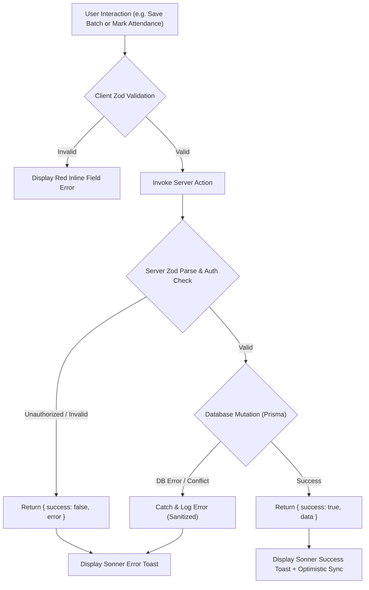

# 03. Engineering Rules, Boundaries & Standards

> **Project:** TutorOS  
> **Document:** Engineering Standards, Boundaries & Error Handling  
> **Status:** Mandatory Guidelines  

---

## 1. What We MUST Do (Best Practices)

1. **Strict TypeScript & Schema Parity:**
   - Always run TypeScript in strict mode. **Zero usage of `any`**.
   - Use **Zod schemas** as the single source of truth for both client-side form validation and server-side data mutations.

2. **Role-Based Access Enforcement (RBAC):**
   - Check user session and authorization level on *every* Server Action and API route.
   - Teachers can only view/mutate data for batches they are assigned to.
   - Students/Parents can only read data associated with their own student profile.
   - Admins hold global management rights.

3. **Batch Segregation Integrity:**
   - Every attendance entry, lesson log, and scheduled session MUST be linked to a valid `batchId`.
   - Prevent cross-batch data leakage by scoping all database queries by tenant / academy ID and batch ID.

4. **Standard Action Response Contract:**
   - Every Server Action must return a standardized, type-safe payload shape:
   ```typescript
   export type ActionResponse<T> = 
     | { 
         success: true; 
         data: T; 
         message?: string; 
       }
     | { 
         success: false; 
         error: string; 
         fieldErrors?: Record<string, string[]>; 
       };
   ```

5. **Optimistic UI with Graceful Rollbacks:**
   - For fast interactions (e.g., toggling an attendance checkbox or changing a session status), update the client UI optimistically and roll back if the server action returns `success: false`.

6. **Accessible & Responsive Design:**
   - Follow WCAG 2.1 AA standards using Radix/Shadcn accessible primitives.
   - Ensure complete responsiveness across mobile phones (essential for tutors logging classes on the go) and desktop monitors.

7. **Subject-Wise Enrollment & Billing Rules:**
   - Prevent duplicate active enrollments for the same student in the same subject batch.
   - For modular students (1 or 2 subjects), billing calculations and invoice generation must only bill for their enrolled subjects, never charging bundle fees unless selected.

8. **Semester Results & GPA Computation Boundaries:**
   - Validation constraints: `0 <= marksObtained <= totalMarks`.
   - Dynamic aggregation: Semester GPA and overall percentage must aggregate **strictly over the student's enrolled subjects**. If Student A only takes Mathematics and Physics, Chemistry marks must not exist or be counted as 0 in their semester GPA.
   - Grade immutability: When a Semester Report Card is marked `PUBLISHED`, marks are locked from casual edits without explicit Admin override.


---

## 2. What We MUST Avoid

1. **Never Expose Private Credentials:**
   - Never prefix private secrets (Database URL, WhatsApp API access token, Resend API key, NextAuth Secret) with `NEXT_PUBLIC_`.
   - Never expose raw database connection logic directly to browser bundles.

2. **Never Allow Unchecked Client Inputs:**
   - Do not trust data coming from the frontend even if it was validated client-side. Always parse payloads through Zod schemas on the server.

3. **Avoid Monolithic Files:**
   - Break components down into atomic pieces when they exceed ~150–200 lines of code.
   - Separate pure presentational UI components from custom business logic hooks.

4. **Avoid Magic Strings & Hardcoded Literals:**
   - Always use TypeScript enums or `as const` arrays for status values:
     - Roles: `'ADMIN' | 'TEACHER' | 'STUDENT' | 'PARENT'`
     - Attendance Status: `'PRESENT' | 'ABSENT' | 'LATE' | 'EXCUSED'`
     - Invoice Status: `'PENDING' | 'PAID' | 'OVERDUE' | 'VOID'`
     - Batch Status: `'ACTIVE' | 'COMPLETED' | 'ARCHIVED'`

5. **Avoid Unhandled Floating Promises:**
   - Always `await` asynchronous database and notification calls, or handle background errors explicitly with try/catch wrappers.

---

## 3. Libraries & Boundaries

### 3.1 Approved Production Libraries

| Category | Approved Library | Purpose |
| :--- | :--- | :--- |
| **UI Components** | `@radix-ui/*` via **Shadcn UI** | Accessible modals, dropdowns, tooltips, dialogs, popovers |
| **Styling** | `tailwindcss`, `tailwind-merge`, `clsx` | Utility-first responsive CSS styling |
| **Form Handling** | `react-hook-form`, `@hookform/resolvers` | High-performance form state management without lag |
| **Validation** | `zod` | Declarative type-safe schema validation |
| **Data Tables** | `@tanstack/react-table` | Sorting, pagination, and filtering for batches, students, teachers |
| **Visual Charts** | `recharts` | Revenue trajectory, attendance rate visualizations |
| **Icons** | `lucide-react` | Clean, modern feather/vector iconography |
| **Notifications** | `sonner` | Toast notification alerts for user interactions |
| **Date Utilities**| `date-fns` | Schedule calculations, recurrence logic, date formatting |

### 3.2 Error Handling & Boundaries Strategy



- **Global Route Boundaries (`error.tsx`):**  
  Placed in `(dashboard)/error.tsx` to ensure any unhandled React render error displays a friendly "Something went wrong" recovery screen with a "Try Again" button, preventing full application whiteout.
- **Loading Boundaries (`loading.tsx`):**  
  Placed at route levels with custom Skeleton screens matching the page structure to prevent Cumulative Layout Shifts (CLS).
