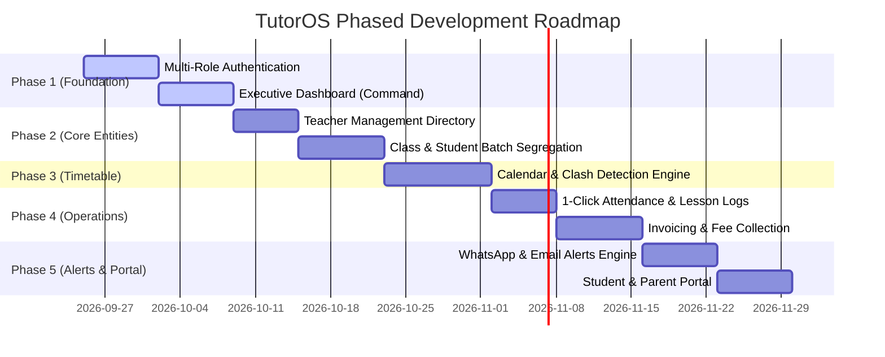

# 04. Phased Implementation Roadmap

> **Project:** TutorOS  
> **Document:** Phased Execution & Milestone Breakdown  
> **Status:** Implementation Ready  

---

## Roadmap Overview

---

## Phase 1: Authentication & Executive Dashboard (Sprint 1)

### Phase 1A: Multi-Role Authentication System
- **Login Flow (`/login`):**
  - Clean split-screen UI (Left: Brand visual & testimonials, Right: Secure form).
  - Multi-role support: Single entry point that securely redirects based on role (`ADMIN` -> `/dashboard`, `TEACHER` -> `/dashboard/teacher`, `STUDENT` -> `/portal`).
  - Sign in via Email & Password + Google OAuth 1-click login.
  - "Remember Me" persistent secure session cookie.
  - "Forgot Password" self-service reset flow with email magic links.
- **Registration Flow (`/register`):**
  - Tutor / Academy registration with Academy Name, Primary Subject, and Phone Number.
- **Route Guarding:**
  - Next.js Edge Middleware intercepting unauthenticated requests and protecting `/dashboard/*` routes.

---

### Phase 1B: Executive Command Center (Dashboard)
- **App Shell Navigation:**
  - Collapsible Sidebar with badge counters (e.g. "3 Classes Today", "5 Overdue Invoices").
  - Top Navigation with search, academy switcher, notifications bell, and user avatar menu.
- **Top Metric Cards (KPIs):**
  1. **Active Students & Batches:** Total enrolled students with month-over-month % trend.
  2. **Monthly Earnings:** Revenue collected vs. monthly financial target with visual progress bar.
  3. **Today's Classes:** Total sessions scheduled for today across all teachers and batches.
  4. **Unpaid Tuition Dues:** Total outstanding invoices requiring follow-up.
- **"Today's Live Agenda" Feed:**
  - Chronological timeline of today's classes showing: Batch Name, Teacher in charge, Time, and Status.
  - Quick action buttons on each session item: `[Join Online Meeting]` or `[Mark Attendance]`.
- **Quick Action Toolbar:**
  - 1-Click modals for immediate admin tasks:
    - `[+ New Student]`
    - `[+ New Batch]`
    - `[+ Add Teacher]`
    - `[+ Schedule Class]`
    - `[+ Create Invoice]`
- **Recent Activity Table:**
  - Real-time log of recent payments recorded, newly enrolled students, and completed classes.

---

## Phase 2: Teacher Management & Batch Segregation (Sprint 2)

- **Teacher Management Directory:**
  - List of all academy teachers with subject tags, hourly rate/salary, and active batch count.
  - Teacher detail view: Assigned batches, weekly schedule, and contact details.
- **Flexible Subject Enrollment Model:**
  - Support full curriculum bundle vs. single/dual (1 or 2) subject enrollment.
  - Subject-specific fee configuration and student-to-subject assignment.
- **Class & Student Batch Segregation:**
  - Batch creation wizard: Name, Subject, Assigned Teacher, Max Capacity, Schedule pattern.
  - Student batch enrollment: Assign students to batches, handle batch transfers, and track batch capacity.
  - Batch-specific view: Roster list, batch timetable, and batch-wise attendance records.

---

## Phase 3: Interactive Calendar & Scheduling Engine (Sprint 3)

- **Multi-View Timetable:** Day, Week, Month, and Teacher-filtered calendar views.
- **Clash Detection Algorithm:** Automatic warning if an instructor or student is assigned to two overlapping classes.
- **Recurring Class Scheduler:** Set recurring weekly patterns (e.g., Every Tuesday & Thursday 4:00 PM).
- **Meeting Links:** Direct integration fields for Zoom, Google Meet, or physical classroom numbers.

---

## Phase 4: Attendance, Lesson Logs, Invoicing & Semester Results (Sprint 4)

- **1-Click Attendance:** Quick toggle for batch attendance with status indicators (`Present`, `Absent`, `Late`, `Excused`).
- **Digital Lesson Logs:** Log topic covered, chapter progress, and homework instructions with submission deadlines.
- **Invoicing System:**
  - Automated invoice generation based on batch monthly fees or modular 1–2 subject tuition rates.
  - Status tracking (`Paid`, `Pending`, `Overdue`).
  - Branded PDF invoice downloads.
- **Semester-Wise Student Results & Report Cards:**
  - Academic Term & Semester management (Semester 1, Semester 2, Midterms, Finals).
  - Rapid marksheet score entry by batch / subject.
  - Automatic GPA & percentage calculation tailored to the student's enrolled subjects.
  - Branded PDF Report Card generation with teacher feedback and remarks.

---

## Phase 5: Automated Alerts & Client Portal (Sprint 5)

- **WhatsApp & Email Alert Engine:**
  - Class reminder alerts 1 hour before scheduled time.
  - Post-class homework and attendance summary sent to parents.
  - Automated reminder for overdue tuition invoices.
  - Instant dispatch of published Semester Report Cards to parents.
- **Student & Parent Portal:**
  - Mobile-first student interface to check batch timetable, lesson notes, homework, fee receipts, and semester results.

